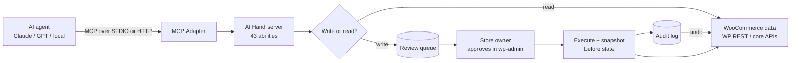

# AI Hand for WooCommerce — Store Operations over MCP

   

**An MCP server that runs inside WordPress and lets an AI agent operate a real WooCommerce store — behind a human approval gate, with undo and a full audit log.**

43 tools covering products, orders, refunds, coupons, customers, fulfilment, content, SEO, reviews, support and marketing. Anything that can cost money or lose data goes into a review queue first; the store owner approves, then it executes.

> 一个 WordPress 插件 = 一个 MCP 服务器，让 AI agent 运营真实 WooCommerce 店铺，共 43 个工具，带审批台 / undo / 审计 / 价格护栏。

---

## Why this exists

There are two common ways to give an LLM access to a store, and both fail the same way:

| Approach | What goes wrong |
|---|---|
| A chat widget that "recommends actions" | It cannot actually do anything, so nothing gets done |
| An LLM with admin REST credentials | No approval step, no undo, no record of what changed |

AI Hand takes a third path: the agent gets **tools, not credentials**, and every state-changing call is planned, reviewed and reversible.

## Architecture



The agent never holds the ability to mutate the store on its own: a queued plan only runs after the owner clicks approve, and the pre-change state is stored so it can be rolled back.

## Safety model

| Layer | What it does |
|---|---|
| **Review queue** | Risky ops are saved as a pending plan with the current product state and a diff preview. The owner approves in **WooCommerce → AI operations review**, then executes separately. A `confirm_token` returned by the agent is *not* accepted as approval. |
| **Undo** | Every write is snapshotted (products, prices, stock, SEO, coupons, settings, redirects, pages). `undo {audit_id}` restores it. |
| **Audit log** | `ok` / `blocked` / `error` are all recorded with arguments and results; `audit-log` queries it. |
| **Guardrails** | Daily limits on refunds and price changes, cost-floor protection on prices, request rate limiting. Read them with `safety-status`. |
| **Owner-only config** | Guardrail settings can only be changed in wp-admin or via WP-CLI. The agent has no tool that can raise its own limits. |

## Quick start

**Requirements:** WordPress 6.9+, WooCommerce 10.9+, PHP 8.0+, and the official [MCP Adapter](https://wordpress.org/plugins/mcp-adapter/) plugin.

```bash
# 1. Install
wp plugin install mcp-adapter --activate
# copy this repo to wp-content/plugins/ai-hand, then:
wp plugin activate ai-hand

# 2. Local (STDIO) — for a desktop AI client
wp mcp-adapter serve --server=ai-hand --user=<shop-manager-account>

# 3. Remote (HTTP) — for a hosted agent, authenticated with an application password
#    endpoint: https://<your-site>/wp-json/ai-hand/mcp
```

Then drop `agent-skill/SKILL.md` into your AI client's skills directory (for example `~/.claude/skills/ai-hand/SKILL.md`) so the model knows how to drive the tools.

### Verify in 60 seconds

1. Activate both plugins. Under **Tools → MCP** (or your MCP client's server list) confirm a server named `ai-hand` is listed.
2. Call `ping` — it must answer with the plugin version and the capability flags.
3. Call `safety-status` — it returns the current refund/price limits. If these are unlimited, stop and set them before going further.
4. Call `store-overview` — it must report your real product and order counts, not zeros.

If step 4 returns zeros on a store with products, the MCP Adapter permission callback is not seeing your logged-in user; check the application password or the `--user` argument.

## Tools (43)

| Group | Tools |
|---|---|
| Probe / overview | `ping` `store-overview` `store-settings` |
| Products | `product-upsert` `product-get` `products-search` `products-bulk-update` `product-delete` `taxonomy-manage` `coupon-manage` |
| Orders | `orders-search` `order-get` `order-create` `order-update` `order-refund` `customers-manage` `sales-report` `order-export` `order-numbers` `invoice` |
| Fulfilment | `shipments` `shipping-rules` `shipping-manage` `tax-manage` |
| Content | `content` `content-upsert` `content-search` `media-upload` |
| SEO | `seo-update` `seo-audit` `seo-settings` `redirects-manage` `merchant-feed` |
| Reviews / support | `reviews` `support` |
| Marketing | `marketing` `conversion` `post-purchase` |
| Site | `site-extensions` `rest-request` |
| Safety / audit | `audit-log` `undo` `safety-status` |

## CLI

```bash
wp hark-store guard set <key> <value>   # change guardrails (owner-side, not exposed to the agent)
wp hark-store guard list
```

## Sibling plugins

AI Hand is one of three plugins that share the same core (`hsm-core.php`, option prefix `hsm_`) and can be active at the same time:

| Repo | Role |
|---|---|
| **ai-hand** (this repo) | Store operations — the day-to-day work |
| [ai-design](https://github.com/baibiaowang/ai-design-for-woocommerce) | Storefront look — theme styles, sections, swatches, product video |
| [ai-tools](https://github.com/baibiaowang/ai-tools-for-woocommerce) | Store infrastructure — backup, mail, consent, pixels, cache, feed, hardening |

## Status

**v1.3.0 — development.** Verified against a local Docker store with 300 products. **Not published on WordPress.org.** The review queue, undo and audit log are the parts most likely to change before a 1.0 release; treat the audit schema as unstable.

## License

GPL-2.0-or-later.
